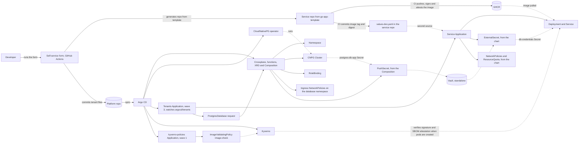

# Self-Service Internal Developer Platform

> I built an internal developer platform that lets a developer go from "I need a new service with a database" to a running, observed, deployed application through a single self-service request — no tickets, no waiting on ops.

That is the target. This README separates what is built and measured today from what is still planned. The platform provisions the database and reports it Ready, and the credentials path (the CloudNativePG Secret, Vault, External Secrets, the service's own Secret) is created automatically for every new service: the database's Composition creates the `PushSecret` and the shared chart creates the `ExternalSecret`. I have confirmed this end to end on one freshly generated service. Image scanning, signing, and verification of the signature and SBOM attestation are in place, and so are network policies and a resource quota for each service and its database (see [Network Isolation and Quotas](#network-isolation-and-quotas)). What is still missing is observability (Phase 5) and a way to remove a service cleanly.

---

## Project Status

Built in phases; this table is the honest picture of what exists today.

| Phase | Scope | Status |
|---|---|---|
| 1. Foundation | k3d cluster, Argo CD (app-of-apps), containerized Go service, CI to GHCR, GitOps deploy | **Done** |
| 2. Self-service infrastructure | Crossplane + CloudNativePG: one `PostgresDatabase` request creates a namespace, team RBAC, and a Postgres cluster | **Done** |
| 3. Self-service request | GitHub Actions form: one typed request creates the service's own repo from a template and commits its Argo CD Application and database request to `argocd/tenants/`; Argo CD and Crossplane do the rest | **Working end to end** (three runs, each ending in a running service and a Ready database). Input checks and preflight are done; failure handling and a timing summary were postponed (see Known Limitations) |
| 4. Guardrails | The service's database connection (External Secrets + Vault), image scanning and signing, Kyverno policies, default-deny network policies and quotas | **In progress.** The database credentials path is done: Vault (standalone mode) and External Secrets are installed and configured, and a new service gets its credentials with no manual step (one fresh service tested). I also tested what happens when Vault is sealed. A changed password reaches a running pod only after a restart; that is documented, not automated. Image scanning (Trivy), SBOM generation, keyless cosign signing and Kyverno verification of the signature and the SBOM attestation are done and enforced: an unsigned image is rejected at admission (see [Image Verification](#image-verification)). Each service namespace has default-deny network policies and a resource quota, and each database namespace has ingress policies; in the tests a pod outside the service could no longer reach the database (see [Network Isolation and Quotas](#network-isolation-and-quotas)). Not built: a way to remove a service cleanly, and egress policy and a quota on the database namespace. Problems hit so far: [troubleshooting log](docs/troubleshooting.md) |
| 5. Observability | Container-level metrics and a per-service dashboard by default (Prometheus + Grafana) | Planned |
| 6. Docs and metrics | Architecture diagram, golden path, before/after numbers | Ongoing |

**Measured so far** (local 3-node k3d cluster):

| Measurement | Result | Notes |
|---|---|---|
| Full rebuild, cluster created to every Application Healthy | **~5 m 08 s** | Read from timestamps on 2026-10-07, from the k3d node container being created to the last Application becoming Healthy. Everything except the CloudNativePG operator was Healthy after 2 m 07 s. The operator was Synced after 13 s but did not become Healthy until 3 m 14 s after that, and I have not found the cause. A rebuild on 2026-10-05 also took about 5 minutes, by eye. Earlier figures were 1 m 22 s at the end of Phase 1 (before Crossplane and CloudNativePG existed) and about 2 m 30 s at the end of Phase 2; neither had a defined stopping point, so they are not comparable |
| Database request to Ready, warm cluster | **~47 s** | 2 instances, `small`. Earlier runs: 43 s, 46 s, 52 s. A request committed to `argocd/tenants/` took 50 s from creation to Ready (read from timestamps) |
| Database request to Ready, first request on a fresh cluster | ~1 m 45 s | Image pulls are the likely cause; not confirmed |
| `git push` to new image running | ~1 m 45 s | One sample. Argo CD polls Git on an interval (see the detection delay below); no webhook on local k3d |
| Argo CD sync to service Ready (hand-built tenant) | ~71 s | One forced sync; approximate, read from the Deployment's age rather than timestamps. Includes the image pull |
| `git push` of a database request to Ready | 6 m 21 s | One sample, timed by clock. Includes Argo CD's polling wait, so it is not a platform time. It is longer than a poll plus the 50 s provisioning would suggest, and I have not yet worked out where the rest went |
| CI duration | 62-181 s | Generated service repos. The 181 s run (2026-10-13) includes Trivy, SBOM, signing and attestation; the form waits for the image-tag commit, which landed at 159 s. Building the image for the scan took 66 s, vet and test 23 s, and the two Trivy scans, SBOM, signing and attestation together 33 s. Step times for the earlier runs were not recorded, so the increase is not broken down |
| Form submit to tenant commit, warm | 79 s, 82 s, 133 s and 184 s | Four samples. Includes validation, repo creation, the new repo's first CI run, and the form waiting for its image tag |
| Argo CD detection delay (commit to the Application appearing) | 116 s, 167 s, 189 s and 261 s | Four samples. Argo CD's default polling interval is 3 minutes and nothing in this cluster changes it, so two of the four samples exceeded it. I have not explained the excess; Argo's reconcile jitter is a candidate I have not confirmed |
| Service platform time, warm | 7 s (two runs before the credentials wiring); 35 s and 81 s (two runs with it) | Application creation to the pod being Ready. The longer figures are the pod waiting for its `db-credentials` Secret. In the 81 s run the Secret appeared 29 s after the database was Ready, after the `ExternalSecret` retried |
| Database request to Ready, measured on the form runs | 22-25 s warm (four samples), 67 s cold | Cold-start cause not confirmed. These runs used a different stopping point from the earlier database rows above, and I have not reconciled the two sets |
| **Form submit to service Ready** | **281 s and 381 s** with the credentials path in place; earlier **278 s and 401 s** | 281 s (2026-10-12): 79 s form to tenant commit, 167 s Argo CD detection delay, 35 s platform time. 381 s (2026-10-13): 184 s, 116 s and 81 s. Argo CD's polling wait is the largest part of the first run and the first CI is the largest part of the second, so polling is reported separately from platform time. The earlier two samples predate the credentials wiring |

The headline metric, developer request to deployed service, is measured: 281 s and 381 s from submitting the form to a Ready service in the two runs that have the credentials path in place (earlier runs: 278 s and 401 s; four runs, local cluster). I report Argo CD's polling wait separately from platform time, because where a commit lands in the poll cycle changes it.

**The first two runs predate the credentials wiring.** They ran on 2026-10-07 at about 03:10 to 03:40 UTC, and the chart started reading the `db-credentials` Secret later that day (Git commit at 20:44 UTC). So those numbers describe a service that did not depend on its database Secret. The 2026-10-12 run is the first with the credentials path in place. Platform time rose from 7 s to 35 s (and 81 s in a later run) because the pod waits for its Secret. In the 2026-10-12 run the pod was created at 00:39:14 UTC and `db-credentials` appeared at 00:39:43 UTC, and the pod was Ready at 00:39:47 UTC. With two runs, I treat 281 s to 381 s as the current range and the earlier two as the Phase 3 result.

The problems I hit while building this, with their causes and fixes, are in the [troubleshooting log](docs/troubleshooting.md).

## The Problem

At most organizations, getting a new service into production means filing a ticket, waiting on a platform/ops team to provision infrastructure by hand, and looping through review cycles that can take days. This project asks: what if a developer could request "a new service with a database" the same way they request a pull request review — and get it in minutes, with security and observability built in by default instead of bolted on afterward?

## What This Platform Does

**Target experience (steps 1 to 5 work today; step 6 works in part; step 7 arrives in Phase 5).** A developer fills out one form (a GitHub Actions workflow with typed inputs). That single action:

1. Validates the request before it lands
2. Creates the service's own repository from a template; that repository's CI builds and pushes the first image
3. Commits the service's Argo CD Application and its database request to `argocd/tenants/`, with no ticket and no human approval step
4. Provisions the backing infrastructure through Crossplane (namespace, database, RBAC)
5. Deploys the service via GitOps — no manual `kubectl apply`, ever
6. Applies guardrails automatically: images from the platform's registry must be signed and attested, each service and its database get network policies, the service gets a resource quota, and no plaintext secrets reach Git
7. Surfaces observability (metrics, dashboards) with zero extra setup

**Working today:** steps 1 to 5. The form validates the request, creates the service's repository from `go-app-template` through the GitHub REST API (with a fine-grained token), waits for that repository's CI to publish the first image, and commits the Application and the database request to `argocd/tenants/`. Argo CD then deploys the service from the shared chart plus the service repo's values file, and Crossplane builds the database, with no `kubectl apply`. This has run end to end four times. **Credentials are automatic too:** the database's Composition creates a `PushSecret` that copies the database password from the CloudNativePG Secret into Vault, and the shared chart creates an `ExternalSecret` that turns it into a `db-credentials` Secret in the service's namespace. On the latest run the service started with no manual step and its `/db` endpoint reported connected. Its pod could not start for about 29 s while it waited for that Secret. **Image verification works too** (see [Image Verification](#image-verification)). **Network isolation and a quota work too** (see [Network Isolation and Quotas](#network-isolation-and-quotas)). **Not working yet:** removing a service cleanly, and the metrics (Phase 5). Behind the form, the database request is one small manifest:

```yaml
apiVersion: rcarlsondevops.org/v1alpha1
kind: PostgresDatabase
metadata:
  name: example-postgresdatabase
spec:
  team: example-team
  instances: 2      # 1 to 3, required
  size: small       # small | medium | large = 1Gi / 2Gi / 3Gi per instance
```

Crossplane turns that into a Namespace (`<name>-db`), a CloudNativePG `Cluster` named `postgres-db` inside it, and a RoleBinding that gives the `spec.team` group the built-in `edit` role in that namespace only. The full request reference, including every field, error message, and generated Secret and Service name, is in [`docs/database-request-format.md`](docs/database-request-format.md).

## Architecture

What is built so far. Prometheus is not drawn because it does not exist yet. The credentials path is drawn with dashed lines for the data flow: the Composition creates the `PushSecret` and the shared chart creates the `ExternalSecret`. The form generates the files in `argocd/tenants/`; they can also still be placed by hand.



## Stack

| Layer | Tool | Status | Why |
|---|---|---|---|
| Cluster | k3d (k3s v1.35.5), 1 server + 2 agents | In use | Reproducible, runs locally, no cloud cost to evaluate |
| GitOps delivery | Argo CD v3.5.3, app-of-apps | In use | Git as the single source of truth; no manual deploys |
| Infrastructure provisioning | Crossplane v2 (chart 2.4.2), pipeline-mode Composition | In use | Kubernetes-native IaC — infra requests are just another API call to the cluster |
| Crossplane functions | function-go-templating v0.13.0, function-auto-ready v0.7.0, function-sequencer v0.6.0 | In use | Template the resources, report readiness, order creation |
| Database | CloudNativePG (chart 0.29.1) | In use | Kubernetes-native Postgres operator; no cloud provider needed locally |
| Service template | GitHub template repository `go-app-template` | In use | The golden path for a service lives in its own repo, so it can be tested and versioned separately from the platform |
| CI | GitHub Actions in each service repo, images in GHCR | In use | Standard, free, widely recognized |
| Supply chain | Trivy (scans, CycloneDX SBOM), cosign (keyless signing and SBOM attestation) | In use | Every image is scanned, signed and attested in its own repo's CI |
| Tenant discovery | One recursive Argo CD Application (sync wave 3) on `argocd/tenants/` | In use | One folder per service; picks up generated Applications and database requests, after the database API is installed |
| Self-service front door | GitHub Actions (`workflow_dispatch` form) | In use | One typed form as the single entry point; no extra tooling to host |
| Policy as code | Kyverno v1.19.1 | In use for image verification (`ImageValidatingPolicy`) | Guardrails enforced automatically, not reviewed manually |
| Secrets | External Secrets Operator (chart 2.12.0) + HashiCorp Vault (chart 0.34.1, standalone mode) | In use; created automatically for each service | No plaintext secrets ever committed to Git; Git holds only references. Standalone rather than dev mode on purpose: I wanted it as close to a production deployment as a local cluster allows, so it has to be initialized and unsealed by hand |
| Network isolation and quotas | Kubernetes NetworkPolicy and ResourceQuota | In use; created automatically for each service | Each service namespace is closed by default and opened one flow at a time; the database namespace accepts connections only from its service, its own instances and the database operator. Enforcement was observed on the local cluster |
| Observability | Prometheus + Grafana | Phase 5 | Metrics available by default for anything deployed through the platform |

## Design Decisions Worth Knowing

- **Small, validated API.** Three inputs. Limits live in the schema, so bad requests (`instances: 500`, a team name with a space, a missing `team`) are rejected at admission with a clear message. Seven such cases were tested against the live API server.
- **The XRD is the contract, the Composition is the implementation.** `size` maps to storage inside the Composition, so the mapping can change without breaking developers.
- **No Crossplane provider.** The Composition emits Kubernetes objects directly, so nothing cloud-specific is needed locally.
- **Namespace per database, fixed Cluster name.** Secret and Service names (`postgres-db-app`, `postgres-db-rw`, `-ro`, `-r`) are predictable, so templates and docs can rely on them.
- **Least privilege for Crossplane.** It may hand out only the `edit` role (the `bind` verb restricted with `resourceNames`), not any role in the cluster. The first version was too wide; I found that by testing the negative case with `kubectl auth can-i`, fixed it, and re-verified.
- **Team access by group, not user.** Membership changes in the identity provider, not in the Composition.
- **Git records what is deployed.** Each service's CI pushes a `sha-<short>` image tag and commits the tag and the image digest to its own `environments/dev/values-dev.yaml`; CI never touches the cluster. By design, the platform repo holds only the Application that points at the service repo, so a new image never needs a commit to the platform repo. I confirmed this on the cluster with a hand-built service: the Deployment's image came from the service repo's values file.
- **One repository per service.** The platform repo is the control plane (shared chart, Argo CD configuration, Crossplane API, generated Applications); service source lives in repos generated from the template. If a service team would own and change a file, it belongs in the template; if the platform owns it, it stays here.
- **One Application per service, two sources.** The generated Application combines the shared chart from this repo with the service repo's values file. The Application name, Helm release name, service name and namespace are the same string, so object names and selectors line up.
- **The team name also becomes a pod label.** The form passes `team` to the service's Application as a Helm parameter, `extraLabels.team`, and the shared chart adds it to the pod labels next to `cost-center`. I checked this on a service whose name and team differ. The chart builds its selectors from separate labels, so an extra label cannot change what a Deployment or Service selects.
- **One folder per service, watched by one recursive Application.** `argocd/tenants/<service>/` holds the service's Application and, optionally, a `PostgresDatabase` request. The watching Application runs at sync wave 3 so the database API exists before any request is applied. A request committed there reached Ready while that Application stayed Healthy.
- **Blueprints are valid YAML with blank values, not placeholders.** The form fills them with `yq` by path and fails the run if any blank is left; plain `envsubst` would also blank Argo CD's `$values` reference. The fill and the check were tested on a copy first, and the form has since run end to end.
- **Every service gets a database.** The form no longer asks whether one is needed; the database request is the heart of what the platform provides.
- **The form waits for the first image tag with its own polling loop.** It watches the tag in the new repo's values file, which is the thing the next step needs, instead of waiting on a generic CI-finished signal.
- **Vault runs in standalone mode, deliberately.** Dev mode starts initialized and unsealed with a known root token, which hides the parts of running Vault that matter. Standalone mode needs a one-time `vault operator init` and three `vault operator unseal` runs (steps in [`docs/setup.md`](docs/setup.md)), which is the cost of the more realistic setup. I drew the line at what a single-node local cluster can do honestly. External Secrets logs in to Vault with Vault's Kubernetes auth, not the root token: a role bound to its own service account, with a policy limited to the `tenants/` paths. I checked that it can write and read there and is denied elsewhere. The first version of the policy was too narrow (a 403 on the metadata path), and I fixed it by adding that path rather than widening the policy. The role is shared by every service for now; a role per service is not built. The root token is used only for one-time setup. Features that only make sense in production (auto-unseal from a cloud KMS, a multi-replica Raft cluster, TLS to Vault) are listed under limitations instead of being faked.
- **The credentials path keeps the database password out of Git and out of the service's code.** CloudNativePG generates the password in its own Secret in the database's namespace. An External Secrets `PushSecret` copies it into Vault, and an `ExternalSecret` in the service's namespace turns it into a `db-credentials` Secret that the shared chart reads with `secretKeyRef`. The service needs that Secret but not Vault when it starts: with Vault sealed, I restarted the service and the new pod still came up.

## Image Verification

Every service image is built in its own repository's CI, scanned with Trivy, signed with cosign and given a CycloneDX SBOM attestation. Signing is keyless: the signature is tied to the workflow's GitHub OIDC identity and recorded in public Sigstore. Signing and attestation use the image digest, and the Deployment references the image by tag and digest.

Kyverno enforces the signature in the cluster. The `kyverno-policies` Argo CD Application (sync wave 1, after Kyverno at wave 0) syncs `kyverno-policies/`, which holds one `ImageValidatingPolicy`, `image-check`. The policy applies when pods are created, checks images under `ghcr.io/rcarlson-devops/`, and passes an image only if it has a valid signature and a signed CycloneDX SBOM attestation, both from a workflow on `main` of a repository under the `rcarlson-devops` account. One policy covers every generated repository, because the identity is matched by pattern and not by repository name.

The policy ran in Audit first (violations reported, nothing blocked) and was then switched to Deny. A signed image passes. An unsigned image under the registry path is rejected at admission:

```
Error from server: admission webhook "ivpol.validate.kyverno.svc-fail" denied the request: Policy image-check failed: Failed to verify the image signature
```

A new service generated by the form started with the policy in Deny. The limits of this check are listed under [Known Limitations](#known-limitations).

## Network Isolation and Quotas

Service namespaces and database namespaces are closed by default and opened one flow at a time. The service side comes from the shared chart, so Argo CD applies it with the service. The database side comes from the database Composition, so Crossplane applies it with the database. Neither needs a step in the form.

**Service namespace (from the chart):**

| Object | Effect |
|---|---|
| `default-deny` | Selects every pod in the namespace and blocks outgoing traffic that no other policy allows. Incoming traffic was not tested |
| `allow-dns` | Lets the pods resolve names |
| `allow-psql` | Lets the pods open port 5432 to the service's own database namespace, `<service>-db`, and nowhere else |
| `resource-quota` | Caps the namespace at 4 pods, 200m and 128Mi of requests, and 800m and 256Mi of limits |

**Database namespace (from the Composition):**

| Object | Effect |
|---|---|
| `default-deny` | Blocks incoming traffic that no other policy allows |
| `allow-service` | Port 5432 from the service's namespace |
| `allow-inter-namespace` | Ports 5432 and 8000 from the database namespace itself, for traffic between instances |
| `allow-cnpg` | Port 8000 from the CloudNativePG operator's namespace |

What I tested, each blocked case against a control that has to work:

- From a service namespace, a pod could not reach the Kubernetes API, which a pod in a namespace without policies could. The service's `/db` endpoint still reported connected.
- Against the database, a pod in the `default` namespace and a pod in another service's namespace could not connect to port 5432. The service's own namespace could.
- A pod with no requests and limits was rejected with an error naming the quota. A rolling restart of the service fit under the quota.
- A new service with two database instances, created after all of this, reached two of two healthy instances.

The limits of this setup are listed under [Known Limitations](#known-limitations).

## Tradeoffs: What I Chose, What I Gave Up

Each choice below has an alternative and a price. The price is the part worth reading.

| I chose | Instead of | What it costs |
|---|---|---|
| Vault plus External Secrets, with a `PushSecret` that copies the database password into Vault | External Secrets reading the CloudNativePG Secret directly, with no Vault | One more stateful component to run. It must be unsealed by hand, and while it is sealed no new service or credential change can sync (running services are unaffected; I tested this once). I chose it because it exercises real secrets management, not because the simpler route could not work |
| Crossplane (a `PostgresDatabase` API) for per-service infrastructure, no Terraform inside the platform | Terraform for the database and namespace | Everything Argo CD applies is applied continuously, with no reviewed plan step. Terraform stays where I would use it for real: the slow-changing foundation (see What's Next) |
| One generated repository per service | Every service in the platform repo | More repositories to manage, and a change to the template does not reach services that were already generated |
| The form commits tenant files straight to `main` | A pull request with human approval | No review gate on generated commits (deliberate: no tickets, no waiting). It also means branch protection on `main` would block the form's commit |
| A fine-grained personal access token for repository creation | A GitHub App with short-lived tokens | Simple to set up, but tied to one person and broader than I would accept at scale. I have not checked whether a GitHub App can create repositories on a personal account |
| Keyless cosign signing (GitHub OIDC identity, public Sigstore) | Signing with a key I manage | Verification depends on public Sigstore being reachable from the cluster (it works from this one). The identity check is a pattern that accepts any repository under the account |
| Image verification that fails closed (`failurePolicy: Fail`) | Letting pods through when Kyverno is unreachable | While Kyverno is down, creating pods is rejected in every namespace except `kyverno` and `kube-system`. The outage case is untested |
| Network policies and a quota in the shared chart, and ingress policies in the Composition | Leaving namespaces open, or writing the policies by hand for each service | Each new flow needs an explicit allow rule; a reachable URL and metrics scraping will each need one. A mistake in the chart reaches every service on the next sync |
| Ingress-only policies on the database namespace, with no quota there | Also restricting the database pods' outgoing traffic and capping the namespace | Outgoing traffic from the database pods is unrestricted and nothing caps that namespace. The database pod declares no CPU or memory requests, so a quota there would need defaults added first |
| A local 3-node k3d cluster | A managed cluster such as EKS | No cloud cost and a fully reproducible rebuild. The Kubernetes API is the same, but there is no real cloud IAM, load balancer or managed storage, and I make no production claims |

**What it costs to run:** nothing in cloud spend, since everything runs on one laptop. I have not yet measured the laptop's memory and CPU use with every component running.

## The Golden Path: New Service in Under 10 Minutes

_Measured on a local cluster: 281 s from submitting the form to a Ready service in the latest run, with the service's credentials set up automatically (earlier runs: 278 s and 401 s). One part is not there yet: the Grafana metrics in step 6 arrive in Phase 5._

1. Open the platform repo's **Actions** tab, select the self-service workflow, and click **Run workflow**
2. Fill in the service and team name, the number of database instances, and the database size
3. Submit — the workflow validates the request, creates the service's repo from the template, waits for its first image, and commits the service's Application to `argocd/tenants/`
4. Argo CD syncs the new commit and Crossplane provisions the infrastructure
5. Watch the rollout in Argo CD
6. Your service is live (metrics in Grafana arrive in Phase 5)

## What's Next at Scale

- **Multi-tenancy:** the service and database namespaces have network policies and the service namespace has a quota. Still open: egress policy and a quota on the database namespace, policies on the platform namespaces, and Argo CD project limits per team
- **Cost tracking:** tag-based cost attribution surfaced back to teams (for example in Grafana) so they see what their infra costs
- **More service types:** expand beyond one service type to cover common patterns (worker/queue consumer, scheduled job, static site)
- **Self-service beyond day 1:** scaling, rollback, and decommissioning through the same self-service workflow, not just creation
- **Database hardening:** backups, a resize path, conditional synchronous replication, read-only and admin role options, and CPU/memory in `size`
- **Narrower Crossplane permissions:** its Namespace rule currently allows all verbs, which is fine locally but too broad for a shared cluster
- **The foundation layer as Terraform:** `bootstrap.sh` is a script because the cluster is a disposable local k3d cluster and k3d has no officially maintained Terraform support. For real clusters, networking, and identity, Terraform is where I would put that slow-changing layer, run by a human with reviewed plans and remote state, leaving Crossplane for per-request resources and Argo CD for everything in Git
- **Faster change detection:** Argo CD polls Git on an interval (the default interval is 3 minutes; the measured delay was 189 s and 261 s), and a local k3d cluster is not reachable by a GitHub webhook. A webhook (or a refresh trigger) would remove that wait on a real cluster
- **A GitHub App instead of a personal token:** the self-service form creates repositories with a fine-grained personal access token tied to one person. A GitHub App with narrow, short-lived installation tokens is the scalable replacement
- **TLS and tracing:** this version has no certificate management (cert-manager) and no distributed tracing
- **A production-grade Vault:** auto-unseal from a cloud KMS so a restart needs no human, a multi-replica Raft cluster, TLS between External Secrets and Vault, and unseal key shares split between several people, and a Vault role and policy per service instead of one shared role. The local setup has one replica, plain HTTP inside the cluster, one shared role, and unseal keys held by one person

## Repository Layout

```
.
├── .github/workflows/       The self-service form
├── argocd/
│   ├── root.yaml            App-of-apps root; the only Argo resource applied by hand
│   ├── apps/                Argo CD Application manifests (plus the Vault store, see platform/)
│   │   ├── operators/       CloudNativePG, Crossplane, Vault, External Secrets, Kyverno
│   │   ├── platform/        Crossplane functions and API, the kyverno-policies Application, and the Vault ClusterSecretStore
│   │   └── workloads/       The Application that watches argocd/tenants/
│   └── tenants/             One folder per service: its Application and its database request
├── bootstrap/               bootstrap.sh, k3d config, pinned Argo CD install
├── charts/app/              Shared Helm chart used by every service, including its network policies and quota
├── crossplane/
│   ├── functions/           The three Crossplane Function packages
│   └── api/                 Crossplane RBAC; database/ holds the XRD and Composition (which also creates the database namespace's network policies)
├── self-service/
│   └── templates/           Application and database blueprints the form fills in (not synced by Argo CD)
├── kyverno-policies/        The ImageValidatingPolicy, synced by the kyverno-policies Application
└── docs/                    Request format doc, one-time setup, and the troubleshooting log
```

Service source code does not live in this repo. Each service is generated into its own repository from the `go-app-template` template repo. `kyverno-policies/` sits outside `argocd/apps/` so that its own Application applies it and the root Application does not. Folders for later work (such as `observability/`) are added as those phases start. The Argo CD Applications for Vault and External Secrets are `hashicorp-vault` and `external-secrets-operator`. Ordering between components comes from sync-wave annotations on the Applications, not from folder name prefixes.

## Running This Locally

Everything outside the bootstrap script is deployed by Argo CD from this repo.

**Prerequisites:** Docker, [k3d](https://k3d.io) v5.x, and `kubectl`. The self-service form also needs a one-time GitHub setup (template repo, access token, Actions secret); see [`docs/setup.md`](docs/setup.md).

**1. Clone the repo**

```bash
git clone https://github.com/rcarlson-devops/self-service-idp.git
cd self-service-idp
```

**2. Run the bootstrap**

```bash
./bootstrap/bootstrap.sh
```

This creates the k3d cluster (`bootstrap/k3d-config.yaml`), installs a pinned version of Argo CD (`bootstrap/argocd/`), and applies `argocd/root.yaml`. From that point Argo CD pulls everything else from Git: the operators, the Crossplane functions, the database API, and the Application that watches `argocd/tenants/`. Expect about 5 minutes until every Application is Healthy; most of it is the CloudNativePG operator (see the measurements above). The 5 minutes was measured before Vault was added and does not include the manual Vault steps in step 4. It is safe to re-run.

**3. Open Argo CD**

The UI is at <https://localhost:8080> (self-signed certificate). Log in as `admin` with the generated password:

```bash
kubectl -n argocd get secret argocd-initial-admin-secret \
  -o jsonpath='{.data.password}' | base64 -d; echo
```

**4. Check that everything synced**

```bash
kubectl -n argocd get applications     # all should end up Synced / Healthy (Vault once unsealed)
```

Vault will not report Healthy until it is initialized and unsealed by hand: once per cluster build, and the unseal again after any Vault pod restart. The commands are in [`docs/setup.md`](docs/setup.md), step 5; steps 6 and 7 there configure Vault for External Secrets and set up a service's credentials. Keep the unseal keys and root token it prints in a password manager, never in Git.

**5. Request a service and its database**

Run the self-service form (see the golden path below). It creates the service's repository and commits the service's Application and its `PostgresDatabase` request to `argocd/tenants/<service>/`; Argo CD applies them on its next poll. Committing finished manifests there by hand also works. Then check:

```bash
kubectl get postgresdatabase           # READY=True after about a minute
kubectl get cluster,pods -n <service>-db
```

Removing a service's folder from `argocd/tenants/` removes the service, its database and the data.

**Tear down**

```bash
k3d cluster delete dev-cluster
```

This removes the cluster and everything in it, including Vault's contents. It does not remove what the form created on GitHub: each generated service repository and its published image stay until you delete them by hand. A decommission workflow that cleans those up is not built.

### How a service's code change is built

Each service repo, generated from `go-app-template`, carries its own CI:

1. Push a change under `app/` to `main`.
2. GitHub Actions vets and tests the code, scans it with Trivy, builds the image, pushes it to GHCR tagged `sha-<short-sha>`, scans the image, generates a CycloneDX SBOM, signs the image digest with cosign and attaches the SBOM as a signed attestation.
3. The workflow commits the image repository, tag and digest to the service repo's `environments/dev/values-dev.yaml`.

Rolling that image out is done by an Application in `argocd/tenants/` that combines the shared chart from this repo with that values file. The form generates that Application.

## Known Limitations

- The service template exposes no application-level metrics; Phase 5 covers container-level metrics only.
- Generated service repositories are public in this version, and so are their images.
- The self-service form creates repositories with a fine-grained personal access token, which is broader than I would accept at scale.
- Argo CD polls Git every 3 minutes by default, and I measured 189 s and 261 s before it noticed a new tenant commit. This is the largest part of the form-to-service time. The interval is configurable and I left it at the default. A webhook cannot reach a local k3d cluster.
- Credentials are created automatically, with caveats. The `PushSecret` comes from the database's Composition and the `ExternalSecret` from the shared chart, so a new service needs no manual step (one fresh service tested on 2026-10-12). Ordering is not enforced: each piece retries until the one before it exists. In that run the pod was created at 00:39:14 UTC and its `db-credentials` Secret at 00:39:43 UTC, and until then the pod reported a missing Secret.
- A changed database password reaches a running service only after the pod restarts. A change in the CloudNativePG Secret flows through the `PushSecret` (hourly) and the `ExternalSecret` (15 s) into `db-credentials`, but environment variables are read when a container starts, so a running pod keeps the old value until it is restarted (`kubectl rollout restart deploy/<service>`). That is standard Kubernetes behavior; I have not tested it here. I did not add a restarter such as Stakater Reloader.
- The form has two inputs: `service` (the repository, Application and namespace name) and `team` (the group that gets the `edit` role in the service's database namespace). The form checks `team` against a pattern, `dev-team-` followed by at least one character, so any `dev-team-<name>` is accepted and anyone who can run the form can grant that group access. A fixed list of team names would be stricter. That is harmless on a local cluster.
- Removing a service is a Git change, and Argo CD prunes automatically: deleting a service's folder deletes the service and, if it has one, its database and data. Deleting the only tenant's folder left the tenants Application OutOfSync with the service still running: Argo CD's `SyncError` said `auto-sync will wipe out all resources`, because automated sync with prune refuses a change that would remove everything in an Application. I left that safeguard on, so removing the last tenant needs a manual step. Once a new tenant existed, the next sync pruned the deleted one. When `form-test` was removed, its database namespace (`form-test-db`, created by Crossplane) was deleted, but its service namespace (`form-test`, created by Argo CD's `CreateNamespace` sync option) stayed behind, empty as far as I could see. Nothing cleans up a removed service's entry in Vault, its GitHub repository, its image or that empty namespace.
- Failure handling is not built: if a form run stops half-way, the repository it created stays, and running the form again with the same name fails until that repository is removed by hand. Input checks run before anything is created: name rules, reserved names (including any name ending in `-db`), an existing repository of the same name, and an existing tenant folder of the same name. The reserved-name list now also covers the Vault and External Secrets Application names (`hashicorp-vault`, `external-secrets-operator`) and the built-in `kube-public` and `kube-node-lease` namespaces. Two runs started at the same moment can still both pass these checks. A run that times out while waiting for the image tag (the step limit is 5 minutes) is cancelled with GitHub's generic timeout message, not a specific one.
- The CI bot commits directly to `main` in each service repo, which would not work with branch protection.
- The service's `/db` endpoint is unauthenticated and opens a new database connection on every call. That is acceptable on a local cluster and is not something to expose. I have not set `sslmode` in the connection URL; I believe the driver tries TLS and falls back to plain without verifying the certificate, but I have not checked which one is used here, so treat database connections as unencrypted.
- Database volumes cannot be resized (the local storage class disallows expansion), and deleting a request deletes its data.
- Two guardrails are built: image verification, covering the signature and the SBOM attestation (see Image Verification), and network isolation with a quota (see Network Isolation and Quotas). Kyverno enforces only the image check. Secrets management covers the database password only: it reaches each service through Vault and External Secrets with nothing in Git, but every service shares one Vault role that can read every service's path under `tenants/`, and the password also still sits in the Secret CloudNativePG generates, which is where Vault's copy comes from.
- Network isolation covers the service and database namespaces only. The platform's own namespaces (Argo CD, Vault, External Secrets, Crossplane, CloudNativePG, Kyverno) have no policies. In the database namespace only incoming traffic is restricted: outgoing traffic from the database pods is not, and the namespace has no quota or default resource requests, because the database pod declares none. In the service namespace the incoming side was not tested, since nothing sends traffic to the services yet; a reachable URL and metrics scraping will each need an allow rule.
- The quota is the same for every service: 4 pods, 200m and 128Mi of requests, 800m and 256Mi of limits. A pod that declares no requests and limits is rejected, so the chart has to set them. A service that needs more has to change the shared chart, which changes every service.
- The network policies and the quota come from the shared chart, so they reach a service on the next sync. A service created before they existed received them the same way.
- Image verification accepts a signature and attestation from any repository under the `rcarlson-devops` account: the policy matches the signing workflow's identity with a pattern, so any workflow on `main` in any of them can produce an image that passes.
- Only images under `ghcr.io/rcarlson-devops/` are checked. Images from other registries are not verified.
- The image policy's webhook fails closed. If Kyverno cannot be reached, creating pods is rejected in every namespace except `kyverno` and `kube-system`, which includes the platform's own namespaces. Kyverno's namespace is excluded so it can restart itself. This case has not been tested.
- Admission checks run when a pod is created. Pods that are already running are reported on by Kyverno's background scan but are not stopped.
- Vault is a local approximation of a production deployment. It runs in standalone mode as a single replica, so it has no fault tolerance; it uses plain HTTP inside the cluster; and it is unsealed by hand, because auto-unseal needs a cloud KMS that a local free-tier setup does not have. The unseal keys and root token are held by one person in a password manager. A cluster rebuild means a new init and new keys, and Vault's contents are lost. A Vault pod restart leaves it sealed until someone unseals it. I tested this once by deleting the Vault pod: its data survived (it is on a persistent volume) and it came back sealed. While it was sealed, the Secret already synced into the service's namespace stayed in place, the running service kept its database connection, and a restarted service pod still came up, because it needs the Secret and not Vault. New Secrets could not be synced, and the External Secrets store reported errors until Vault was unsealed (its status lagged the seal at first). After the unseal, syncing resumed with no action, in about 4 minutes 19 seconds in that one run. A sealed Vault therefore blocks new services and credential changes but not running ones. I did not test what the `PushSecret` does while Vault is sealed.
- Timings are from one local machine, several are single samples, the cold-start explanation was not verified, and the slow start-up of the CloudNativePG operator (seen in two rebuilds) is unexplained.

## About This Project

Built by [Robert Carlson](https://www.linkedin.com/in/robertjohncarlson) as a hands-on demonstration of platform engineering practices — self-service infrastructure, GitOps, policy-as-code, and observability by default — following 10+ years in DevOps and cloud engineering across AWS, Azure, and Kubernetes environments.
